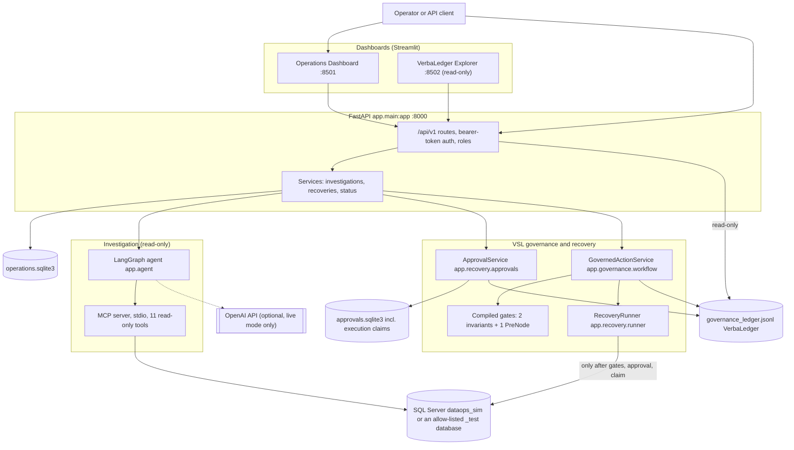
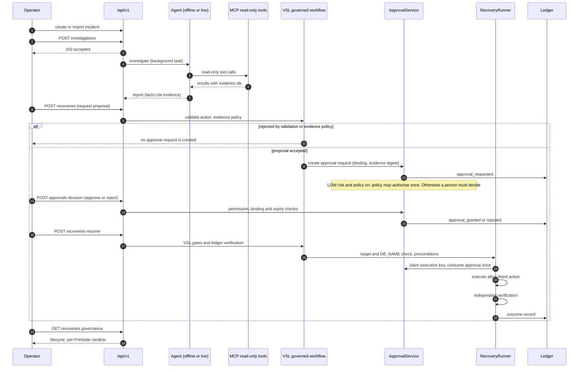
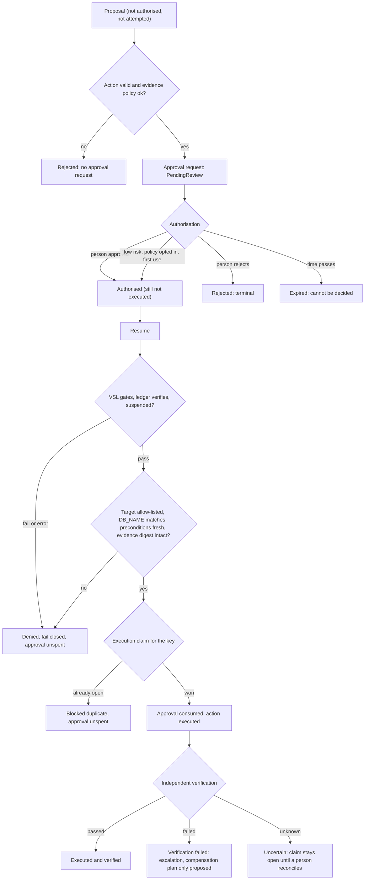

# VSL-Governed AI DataOps Agent

An AI-assisted incident workflow for DataOps. An agent investigates data-pipeline incidents using read-only tool evidence,
and any proposed fix passes through **VSL governance** before it can touch anything: deterministic checks, a person's approval
(or an explicit, opt-in low-risk policy), a single-use idempotent execution claim, independent verification, and a hash-chained
audit ledger.

> **Scope.** The system runs against a **simulated** data platform (a SQL Server simulation database plus in-memory fakes).
> Recovery acts only on an in-memory simulation or an allow-listed SQL Server database whose name ends in `_test`. Authentication
> is a development-only static-token scheme. This is a reference implementation, **not production-ready**; the verification status
> of each claim is in [docs/release-readiness.md](docs/release-readiness.md).

**Problem.** When an AI agent can investigate failures and start recovery, the hard part is not diagnosis. It is bounding what
the agent may do, proving who authorised it, preventing duplicate execution, and keeping an audit trail that distinguishes
"proposed", "approved", "attempted" and "verified".
**Intended users.** Engineers and architects evaluating governed AI-agent patterns for DataOps (LangGraph orchestration, MCP
tooling, human-in-the-loop approval, VSL-governed execution, audit trails), and reviewers of that design.

## Contents

1. [Executive summary](#1-executive-summary)
2. [Problem statement and design goals](#2-problem-statement-and-design-goals)
3. [System architecture](#3-system-architecture)
4. [End-to-end workflow](#4-end-to-end-workflow)
5. [VSL governance integration](#5-vsl-governance-integration)
6. [Worked examples](#6-worked-examples)
7. [Technology stack](#7-technology-stack)
8. [Repository structure](#8-repository-structure)
9. [Installation and local setup (Windows)](#9-installation-and-local-setup-windows)
10. [Configuration reference](#10-configuration-reference)
11. [API and dashboard](#11-api-and-dashboard)
12. [Testing and quality assurance](#12-testing-and-quality-assurance)
13. [Security, safety and operational limitations](#13-security-safety-and-operational-limitations)
14. [Implementation status and roadmap](#14-implementation-status-and-roadmap)
15. [Contributing and license](#15-contributing-and-license)
16. [Troubleshooting and shutdown](#16-troubleshooting-and-shutdown)
17. [Documentation index](#17-documentation-index)
18. [Summary](#18-summary)

---

## 1. Executive summary

| Question | Answer |
|---|---|
| What is it? | An incident-investigation and governed-recovery workflow: FastAPI backend, LangGraph agent, read-only MCP diagnostic tools, VSL governance gates, approval service, recovery runner, ledger, and two Streamlit dashboards |
| Which problems does it address? | Explaining why a pipeline failed from cited evidence; proposing a bounded fix; requiring authorisation; preventing duplicate or unsafe execution; recording an auditable history |
| What does AI contribute? | **Analysis only.** The agent plans which read-only tools to call and drafts a report (observed facts, interpretation, hypotheses). The default mode is a deterministic offline heuristic, not an LLM. Live OpenAI mode exists but has not been run |
| What does VSL contribute? | Compiled gates that run *before* the protected action: two invariants (action allow-list; no execution while automation is suspended) and one PreNode (verified report, cited evidence and a valid approval) |
| What is deterministic code, not VSL? | Target guard, risk classification, approval binding and expiry, evidence policy and digest, idempotency claim, lifecycle, verdict derivation. These are ordinary tested Python, labelled as such |
| Why is it useful? | Model output is never an authority. A fix is a *proposal*; it executes only after code-enforced checks and an authorisation that a model cannot produce |

**AI-generated vs enforced.** The report, hypotheses and the choice of proposed action are model-or-heuristic output. Everything
that decides whether anything runs (policy, authorisation, expiry, allow-lists, claims, verification) is deterministic code.
Model confidence is never an input to a decision.

## 2. Problem statement and design goals

Realistic DataOps situations, and whether this repository handles them:

| Situation | Handled? |
|---|---|
| Failed pipeline runs, data-quality violations, duplicate records, stale or incomplete data, schema mismatch | **Simulated** scenarios (`pipeline-failure`, `data-quality`, `duplicate-records`, `stale-data`, `incomplete-processing`, `schema-mismatch`) can be activated and investigated |
| SQL errors, infrastructure or resource anomalies | Only as modelled by the simulator; no real infrastructure monitoring |
| Repeated recovery attempts | Bounded: at most one automatic (policy) authorisation per incident, action and target; others need a person |
| Duplicate execution from retries or concurrent requests | Controlled by a unique execution claim per operation key (see [Example 4](#example-4-duplicate-or-concurrent-recovery-request)); not exactly-once for external effects |
| Changes that need authorisation | Enforced: high-risk and unknown actions never run without a persisted human approval |
| Auditability of AI-assisted operations | Hash-chained ledger of governance events (tamper-evident, not immutable) |

**Design goals:** the model reads but cannot act; authorisation is separate from execution; every gate fails closed; outcomes
are verified independently before being called success; docs and UI never present a proposal or an approval as an execution.
**Non-goals:** real data-platform integration, a production identity provider, executable rollback, multi-replica deployment,
compliance certification.

## 3. System architecture

### Diagram 1: components



Existing vs optional: OpenAI, GitHub Issues ticketing (`app/integrations/github_issues.py`) and the Explorer are optional; the
rest is part of the default flow. Four stores on purpose: the SQL database (simulation), the operations store, the approval
store, and the ledger.

### Diagram 2: incident lifecycle



### Diagram 3: governance decision flow



## 4. End-to-end workflow

| # | Stage | Trigger and component | Input to output | Failure and controls |
|---|---|---|---|---|
| 1 | Incident intake | `POST /api/v1/incidents`, or `POST /api/v1/simulator/incidents/{id}/import` (idempotent) | Title, description, type, severity to a workflow incident in `operations.sqlite3` | Strict schema validation. Synthetic `DEMO-nnnn` incidents are browse-only |
| 2 | Evidence collection | Agent `execute_tools` node (`app/agent/`) over stdio MCP (`app/mcp_server/`) | Tool calls to results, each with an evidence id | Only approved read-only tools; budgets: 3 rounds, 12 calls, 4 per round |
| 3 | Investigation | Agent `plan`, `evaluate`, `generate_report` (offline heuristic or live model) | Evidence to a report: facts, interpretation, hypotheses, limitations | `finalize_report` rejects findings citing unknown evidence; hypotheses never supply evidence to a proposal |
| 4 | Action planning | `POST /api/v1/incidents/{id}/recoveries` | Report to a proposal (action derived by code from evidence unless an allow-listed action is supplied) | `validate_action`: two actions only, strict parameter schemas, no free SQL |
| 5 | Governance evaluation | `GovernedActionService`, evidence policy | Proposal, evidence metadata to pass/deny | PN-03/PN-02 deny before any approval request exists |
| 6 | Authorisation and approval | `ApprovalService` | Request to approved/rejected/expired | Per-action approver permission, binding digest, HMAC seal, single use, expiry (default 30 min) |
| 7 | Resume and execution | `POST /api/v1/recoveries/{id}/resume`, `RecoveryRunner` | Approved request to executed, failed, uncertain or refused | Gates, ledger verification, target guard, fresh preconditions, execution claim, atomic consume |
| 8 | Verification and recovery outcome | Runner postcondition re-read | Result to `executed`/`verification_failed`/`uncertain` | Failure or unknown: escalation and a compensation **plan** (not executed); no automatic retry |
| 9 | Persistence and audit | `GovernanceRecorder` to ledger; stores | Every decision and outcome appended | Unreadable or non-verifying ledger denies execution |
| 10 | Reporting | `GET /recoveries/{id}/governance`, dashboards, Explorer | Stored rows and ledger outcomes to lifecycle and verdicts | Missing records are shown as `NOT RECORDED (this is not a pass)` |

## 5. VSL governance integration

The governance layer uses the `vsl_core` constructs through the `vsl_langgraph` adapter, both pinned in `requirements.txt`.
It is wired around the protected action. Only constructs that exist in the code are described.

| Primitive | Name in code | Purpose | Where | Evaluated | Can permit / reject | Evidence |
|---|---|---|---|---|---|---|
| Invariant | `action_within_allowlist` | The action type is allow-listed | `app/governance/policy.py`, compiled in `gates.py` | At resume, before the action | Rejects any non-allow-listed action | `test_t08_arbitrary_sql_unsupported_actions_and_malformed_model_output_are_rejected` |
| Invariant | `no_execution_while_suspended` | Nothing runs while automation is suspended; suspension is read from the ledger, never from the caller | `policy.py`, `workflow.py` | At resume | Rejects while a terminal state is open | `tests/test_governance_acceptance.py` (T-05 group), `docs/governance-catalogue.md` |
| PreNode | `verified_report_and_approval` | Report is `issue_identified`; root cause supported by known evidence; evidence policy holds; approval valid for exactly this action | `policy.py` (`failed_preconditions`, `evidence_failures`) | At proposal and again before execution | Denies (`denied_human_review`) if any precondition fails | `test_t18_the_governed_action_service_denies_without_a_valid_approval`, `tests/test_governance_evidence.py` |
| TerminalState | `automation_suspended` | Entered when an invariant is violated; only a named human can clear it | `policy.py`, `ledger.py` | On violation | While open, further actions are `refused_suspended` | `docs/vsl-governance.md`; clearing is **not** exposed over HTTP |
| Gamma encoding | `PASS_GAMMA`/`FAIL_GAMMA` | The PreNode monitor is Python that encodes "all preconditions hold" as gamma 2.0 and failure as 0.0 | `policy.py` | With the PreNode | Binary, **not** a calibrated confidence | `docs/vsl-governance.md` |
| Ledger | VerbaLedger (`GovernanceRecorder`, `open_ledger`) | Hash-chained JSONL record of decisions and outcomes | `app/governance/ledger.py`, `ledger_view.py` | At each decision | Failed verification denies execution | `test_t07_failed_ledger_verification_denies_execution` |

Not claimed: assurance beyond the adapter's lowest level (the gates run before the action but do not modify any model's energy
function); VSL does not itself provide idempotency, risk classification, approval or target checks. Those are controls built beside it.

**Controls implemented as ordinary code, mapped to the governance catalogue** ([docs/governance-catalogue.md](docs/governance-catalogue.md)
lists 8 PreNode stages PN-01..PN-08 and 22 invariants INV-01..INV-22 with status, enforcement point and test):

| Concern | Mechanism | Evidence |
|---|---|---|
| Risk classification | `risk-policy-v1` (`app/recovery/risk_policy.py`): `rerun_pipeline` for `order_validation`/`reporting_prep` is LOW; for `order_ingestion` HIGH; `remove_injected_condition` HIGH; anything else UNKNOWN (denied). Model output and confidence are never inputs | `tests/test_risk_policy.py` |
| Automatic authorisation | Off unless `RECOVERY_AUTO_AUTHORIZE_LOW_RISK=true`; LOW only; one automatic authorisation per incident, action and target | `test_demo_scenario_a_bounded_low_risk_retry`, `test_policy_disabled_by_default_leaves_the_request_waiting_for_a_person` |
| Human approval | Bound to action, parameters, target, evidence; HMAC-sealed; single use; per-action permission; expiry enforced server-side | `test_t03_...`, `test_t11_roles_without_the_approval_permission_cannot_approve_or_reject`, `tests/test_approval_expiry_presentation.py` |
| Target restrictions | In-memory fake or `*_test` database in `RECOVERY_TARGET_ALLOWLIST`; `dataops_sim`/system databases never; live `DB_NAME()` must match | `test_demo_scenario_d_unsafe_targets_are_refused_before_anything_runs`, `test_t06_configured_and_actual_target_mismatch_is_denied_before_any_write` |
| Evidence policy | Provenance metadata, known read-only tool, supporting status, same investigation, age at most 60 min; SHA-256 digest recorded at request and re-verified before execution | `tests/test_governance_evidence.py` |
| Idempotency | Key `idem-` + SHA-256 prefix of incident, action, parameters, target; unique open claim per key; `uncertain` blocks reruns until reconciled | `tests/test_governance_idempotency.py`, `test_t14_concurrent_resumes_execute_the_operation_exactly_once` |
| Lifecycle | Final recoveries are never reopened; resuming is entered by one atomic claim | `tests/test_governance_lifecycle.py` |
| Fail closed | Gate errors, unreadable or non-verifying ledger, unknown risk, target mismatch, missing evidence digest: deny and leave the approval unspent | `test_t07_...` group, `test_t18_...` group |
| Retry and recovery boundaries | Failed or uncertain outcomes escalate, propose a compensation plan (`executable=False`) and never retry automatically | `test_demo_failure_path_escalates_with_a_plan_and_no_retry` |
| Auditability and verdicts | Per-PreNode verdicts `passed`/`failed`/`unknown`/`not_recorded`, basis `recorded`/`implied_by_later_step`/`none` | `tests/test_governance_prenodes.py` |

Details: [docs/governance-and-safety.md](docs/governance-and-safety.md), [docs/governance-catalogue.md](docs/governance-catalogue.md),
[docs/vsl-governance.md](docs/vsl-governance.md).

## 6. Worked examples

All data below is synthetic. The pseudocode is illustrative, not captured output; no execution log is claimed.

### Example 1: duplicated order records (failed data quality)

* **Scenario.** The simulator's `duplicate-records` scenario is active (`python -m scripts.scenario activate duplicate-records`) and an operator reports "orders look wrong".
* **Trigger.** `POST /api/v1/incidents` then `POST /api/v1/incidents/{id}/investigations`.
* **Agent's proposed response.** The offline heuristic calls read-only tools, cites the evidence ids showing repeated order ids, and proposes `remove_injected_condition` for scenario `duplicate-records`.
* **VSL governance evaluation.** The proposal passes action validation and the PN-02 evidence policy (fresh, known tool, supporting status), producing an approval request with a binding digest and an evidence digest recorded in the ledger. Risk class: HIGH, so a person is required.
* **System behaviour.** The recovery shows PendingReview; nothing is authorised or attempted.
* **Expected outcome.** Nothing changes until a person approves and the recovery is resumed (Example 3).
* **Evidence.** `test_t03_high_risk_reprocess_needs_a_persisted_approval_and_runs_only_after_all_checks`; `test_demo_end_to_end`.

### Example 2: prohibited or destructive action

* **Scenario.** A caller or a manipulated model output proposes arbitrary SQL or an action outside the allow-list, or text in the reason field tries to instruct the system.
* **Input (illustrative).** `{"action_type": "drop_table", "parameters": {"table": "orders"}}`. The API schema accepts only `rerun_pipeline` and `remove_injected_condition`, and `validate_action` rejects unsupported actions, unknown parameter fields and malformed values.
* **VSL governance evaluation.** The `action_within_allowlist` invariant and PN-03 reject it. Instruction-like text in a reason field is data and changes nothing.
* **System behaviour.** No approval request is created; nothing executes.
* **Evidence.** `test_t08_arbitrary_sql_unsupported_actions_and_malformed_model_output_are_rejected`, `test_t08_a_prompt_injection_in_the_reason_text_changes_nothing`. Unsafe database targets (`dataops_sim`, `master`, an unlisted `_test` database) are refused before anything runs: `test_demo_scenario_d_unsafe_targets_are_refused_before_anything_runs`.

### Example 3: human approval required

* **Scenario.** The high-risk proposal from Example 1 is waiting.
* **Input (illustrative).** `POST /api/v1/approvals/{request_id}/decision` with `{"decision": "approve", "reason": "evidence reviewed"}` using an approver token.
* **VSL governance evaluation.** The route needs `approval:decide`; `ApprovalService` separately requires the per-action approver permission, a valid unexpired request and an unchanged binding. A viewer, unauthenticated or revoked caller is refused. Approval is recorded as `approval_granted` and executes nothing.
* **System behaviour.** Resuming before approval returns *awaiting approval*. After approval, `POST /api/v1/recoveries/{recovery_id}/resume` runs the gates, ledger verification, target check, claim, single-use consume, execution and independent verification. Replaying the spent approval is refused.
* **Expected outcome.** `executed` with verified outcome only if the postcondition check passed; the approval is `consumed`. An approval left past its expiry shows **EXPIRED** and cannot be decided.
* **Evidence.** `test_t03_...` (order: `approval_granted`, then `recovery_attempt`, then `recovery_succeeded`), `test_t11_roles_without_the_approval_permission_cannot_approve_or_reject`, `test_t21_human_approval_does_not_imply_that_anything_executed`, `tests/test_approval_expiry_presentation.py`.

### Example 4: duplicate or concurrent recovery request

* **Scenario.** Two approved requests for the same operation (same incident, action, parameters and target) are resumed at the same moment, from separate service objects sharing one approval database.
* **VSL governance evaluation and mechanism.** Before executing, the runner inserts a row into `execution_claims`. A unique index allows one open claim per idempotency key, so exactly one resume wins. The loser gets `duplicate_or_unreconciled_operation`, executes nothing, and its approval stays unspent. If the winner's outcome is `uncertain`, its claim stays open and blocks the operation until a person reconciles it (service method only).
* **System behaviour.** One execution, one refusal. A second approved request that arrives *after* the first has settled is a separate deliberate rerun and is allowed.
* **Evidence.** `test_two_approvals_for_the_same_operation_run_it_exactly_once_when_resumed_concurrently` holds the winner inside the executor until the loser finishes, so the overlap is not timing luck; `test_t14_concurrent_resumes_execute_the_operation_exactly_once`; `test_a_success_settles_the_claim_and_a_later_deliberate_rerun_is_allowed`.
* **What it does not show.** Not a distributed exactly-once guarantee: the external effect cannot join the SQLite transaction, and a crash mid-execution leaves the claim open.

### Additional scenarios

* **Offline investigation** makes no external connection and builds no live client: `test_t19_offline_investigation_makes_no_external_connection_and_does_not_use_a_model_client`, `tests/test_governance_offline_mode.py`.
* **Bounded low-risk retry** (opt-in policy, one use): `test_demo_scenario_a_bounded_low_risk_retry`.
* **Failure and escalation** (plan proposed, no retry): `test_demo_failure_path_escalates_with_a_plan_and_no_retry`.

Run the narrated demo with `python -m pytest tests/test_governance_demo.py -s -q`; see [docs/demo-guide.md](docs/demo-guide.md).

## 7. Technology stack

From `requirements.txt`, `requirements-dashboard.txt`, `pytest.ini`, `Dockerfile` and `.github/workflows/ci.yml`:

| Category | Technology | Purpose | Required? |
|---|---|---|---|
| Language | Python 3.10+ (CI matrix 3.10 and 3.12) | Runtime | Required |
| API | FastAPI 0.143.2, Uvicorn 0.54.0, Pydantic 2.14.1, pydantic-settings 2.15.0 | HTTP API, validation, settings | Required |
| Agent orchestration | LangGraph 1.2.16 | Investigation and recovery graphs | Required |
| Tool layer | `mcp` 2.3.0 (stdio) | Read-only diagnostic tools | Required |
| AI model | `openai` 3.31.0; default model name `gpt-4o-mini` | Live investigation only | Optional (default is the offline heuristic) |
| Governance | `super-semantics-vsl` (`vsl_core`), `vsl-langgraph`, pinned GitHub commits | VSL constructs and gate compilation | Required |
| Persistence | SQLAlchemy 2.0.54 + pyodbc 5.3.0 (SQL Server simulation); SQLite (operations and approval stores); JSONL ledger | State and audit | SQL Server optional for tests |
| Dashboard | Streamlit 1.65.0, Plotly 7.1.0, pandas 2.3.3 | Operations Dashboard, Explorer | Optional (`requirements-dashboard.txt`) |
| Config | PyYAML 6.0.2 (`config/data_quality_rules.yaml`) | Data-quality rules | Required |
| Tests | pytest 9.1.1, httpx, Streamlit `AppTest` | Offline test suite | Dev |
| CI / packaging | GitHub Actions workflow, `Dockerfile`, `docker-compose.yml` | Foundations | Present, never observed running |

## 8. Repository structure

```text
app/
  main.py               FastAPI root app; mounts /api/v1
  config.py             Settings from environment
  api/v1/               routes/, security.py, permissions.py, errors.py, schemas.py
  agent/                LangGraph investigation: graph, offline model, llm, prompts, report, mcp_client
  mcp_server/           Read-only MCP server and tool provider
  diagnostics/          Read-only diagnostic queries
  governance/           policy.py (VSL constructs), gates.py, workflow.py, ledger.py, ledger_view.py, audit_cli.py
  recovery/             actions, approvals, auth, risk_policy, runner, workflow, lifecycle, expiry,
                        governance_view, prenode_verdicts, governance_catalogue
  services/             container (wiring), investigations, recoveries, status
  persistence/          SQLite schema and repositories
  simulation/ demo/     SQL Server simulator and in-process synthetic incidents
  integrations/         github_issues.py (optional)
dashboard/              ops_app.py, ledger_app.py, clients and view models
scripts/                db_*, dev_stack, check_prereqs, check_database_identity, scenario, investigate, ...
config/                 data_quality_rules.yaml
tests/                  pytest suite; tests/integration/ needs a real SQL Server and is destructive
docs/                   operating and design documentation
data/ logs/ .dev/ .env  local runtime state and secrets (git-ignored)
```

## 9. Installation and local setup (Windows)

Prerequisites: Windows 10/11 PowerShell, Git, 64-bit Python 3.10+, access to GitHub and PyPI (the VSL packages install from pinned
GitHub commits). For the SQL Server simulator: SQL Server (Express is fine) and Microsoft ODBC Driver 17/18
([docs/windows-setup.md](docs/windows-setup.md)). The automated tests need neither SQL Server nor an OpenAI key.

```powershell
git clone https://github.com/rahesh-supersemantics/AI-DataOps-Agent.git
cd AI-DataOps-Agent
python -m venv .venv
.\.venv\Scripts\Activate.ps1
python -m pip install -r requirements.txt
python -m pip install -r requirements-dashboard.txt
Copy-Item .env.example .env        # first time only; edit with notepad .env
```

`.env` is git-ignored. **Never commit `.env`, API keys, passwords, tokens or real operational data.** `.env.example` contains
placeholders only. If activation is blocked: `Set-ExecutionPolicy -Scope Process RemoteSigned`.

Initialise the simulation database once (each script reports the database it uses):

```powershell
python -m scripts.check_prereqs
python -m scripts.db_init
python -m scripts.db_seed
python -m scripts.db_verify
python -m scripts.check_database_identity     # read-only: server and database the app will use
```

Start the API and both dashboards with development tokens generated for you:

```powershell
.\.venv\Scripts\python.exe -m scripts.dev_stack --show-approver-token --open
```

| Service | URL |
|---|---|
| API docs | <http://127.0.0.1:8000/docs> |
| Operations Dashboard | <http://127.0.0.1:8501> |
| VerbaLedger Explorer | <http://127.0.0.1:8502> |

API only: `python -m uvicorn app.main:app --host 127.0.0.1 --port 8000`. Run offline investigations without any key:
`INVESTIGATION_MODE` defaults to `offline`. **Recovery is intentionally unavailable (HTTP 503 `recovery_unavailable`) while
`DB_NAME=dataops_sim`**; enabling it needs a separate allow-listed `_test` database, described in
[docs/installation-and-configuration.md](docs/installation-and-configuration.md#enabling-recovery-safely).

## 10. Configuration reference

Source: `app/config.py`, `app/services/container.py`, `app/recovery/auth.py`, `app/recovery/approvals.py`, `app/core/startup.py`, `.env.example`.

| Variable | Purpose | Default | Required | Notes |
|---|---|---|---|---|
| `APP_ENV` | `development`, `test`, `production` | `development` | Optional | `production` enables fail-closed start-up validation and refuses `dev_static` |
| `INVESTIGATION_MODE` | `offline` heuristic or `live` model | `offline` | Optional | `live` is billable, sends incident text and tool output to the provider, and has not been run |
| `OPENAI_API_KEY`, `OPENAI_MODEL` | Live model credentials and name | none, `gpt-4o-mini` | Only for live | Secret; local `.env` only |
| `DB_SERVER`, `DB_NAME`, `DB_AUTH_MODE`, `DB_DRIVER` | SQL Server simulation connection | `localhost`, `dataops_sim`, `windows`, ODBC Driver 18 | Optional | `DB_NAME` selects the recovery guard outcome |
| `DB_USER`, `DB_PASSWORD` | SQL authentication | none | Only for `sql` mode | Secrets |
| `DB_ENCRYPT`, `DB_TRUST_SERVER_CERTIFICATE`, `DB_LOGIN_TIMEOUT_SECONDS` | Connection options | `true`, `false`, `5` | Optional | Trust-certificate `true` only for local development |
| `RECOVERY_TARGET_ALLOWLIST` | SQL databases recovery may write to | empty | Optional | Entries must also end `_test`; empty means no SQL target |
| `RECOVERY_AUTO_AUTHORIZE_LOW_RISK` | Opt-in policy authorisation of one low-risk retry | `false` | Optional | Never covers HIGH or UNKNOWN |
| `APPROVAL_AUTH_MODE` | `disabled` or `dev_static` | `disabled` | Optional | `disabled`: nobody can approve |
| `APPROVAL_DEV_CREDENTIALS` | JSON list of subject, `token_sha256`, roles | unset | With `dev_static` | Digests only; generated by `dev_stack` |
| `APPROVAL_SIGNING_KEY` | Seals approvals | unset | For approvals | Secret; unset means approvals unavailable |
| `DATABASE_URL`, `APPROVAL_STORE_PATH`, `GOVERNANCE_LEDGER_PATH` | Locations of the operations store, approval store, ledger | `data/...` | Required explicitly in production | |
| `GITHUB_TOKEN`, `GITHUB_OWNER`, `GITHUB_REPO` | Optional ticketing | none | Optional | Secret token |
| `SIM_SEED`, `FRESHNESS_THRESHOLD_MINUTES`, `SIM_LOG_DIR`, `LOG_LEVEL`, `API_HOST`, `API_PORT` | Simulator and server settings | see `.env.example` | Optional | |
| `RUN_SQLSERVER_TESTS`, `TEST_DB_NAME`, `SQLSERVER_TESTS_CONFIRM_WIPE` | SQL Server integration tests | unset | Tests only | **Destructive**: the fixture wipes and reseeds its target |

Full table with notes: [docs/installation-and-configuration.md](docs/installation-and-configuration.md).

## 11. API and dashboard

Interactive documentation is served at `/docs`; the full route list (42 paths) is in [docs/api-reference.md](docs/api-reference.md).
All `/api/v1` routes except `health` and `ready` need `Authorization: Bearer <token>`; errors share one shape,
`{"error": {"code", "message", "request_id", "details"?}}`.

| Area | Routes |
|---|---|
| Health | `GET /health`, `/ready`, `/api/v1/health`, `/api/v1/ready` |
| Incidents | `POST/GET /api/v1/incidents`, `GET /api/v1/incidents/{id}`, `/status`, simulator list/import under `/api/v1/simulator/...` |
| Investigations | `POST/GET /api/v1/incidents/{id}/investigations` (202), `GET /api/v1/investigations/{id}`, `GET /api/v1/incidents/{id}/report` |
| Recovery | `POST/GET /api/v1/incidents/{id}/recoveries`, `GET /api/v1/recoveries`, `/recoveries/{id}`, `/recoveries/{id}/governance`, `POST /recoveries/{id}/resume` |
| Approval | `GET /api/v1/reviews...`, `GET /api/v1/approvals/{id}`, `POST /api/v1/approvals/{id}/decision` |
| Ledger (read-only) | `GET /api/v1/ledger/summary`, `/events`, `/events/{id}`, `/trace`, `/integrity`, `/audit` |
| Other | tickets (optional), `/api/v1/demo/*`, `/api/v1/dashboard/summary`, unauthenticated read-only `/sim/*` |

Synthetic request bodies (field names from `app/api/v1/schemas.py`):

```json
POST /api/v1/incidents
{"title": "Orders look wrong", "description": "Order counts look duplicated after the nightly load.",
 "incident_type": "duplicate_records", "severity": "high"}

POST /api/v1/approvals/{request_id}/decision
{"decision": "approve", "reason": "Evidence reviewed"}
```

The recovery request body is optional; without one the action is derived by code from the investigation's evidence. `RecoveryOut`
exposes `status`, `phase`, `execution_status`, `verified_outcome`, `reasons`, `approval_request_id` and `decision_id`.

**Operations Dashboard** (`dashboard/ops_app.py`) pages: Overview, Pipelines, Data Quality, Incidents, AI Investigations, Run History,
Human Review, Recovery & approvals, Tickets, Settings. It is read-only except for approval decisions, starting investigations and
importing simulator incidents, all via the API. **VerbaLedger Explorer** (`dashboard/ledger_app.py`) is read-only. Neither has a UI login;
both use API tokens from the launcher.

## 12. Testing and quality assurance

```powershell
python -m pytest -q                     # offline suite: no SQL Server, no OpenAI key, no network
python -m pytest -q -rs                 # also list why tests were skipped
python -m pytest tests/test_governance_demo.py -s -q
python -m scripts.generate_governance_docs   # after changing the catalogue, lifecycle or acceptance map
```

No test totals are quoted here; counts change, so run the command. Recorded results and caveats are in
[docs/testing-and-verification.md](docs/testing-and-verification.md). SQL Server integration tests (`pytest -m integration`) and the
live-model test are skipped by default; **a skip is not a pass**. The integration suite is destructive and now requires
`SQLSERVER_TESTS_CONFIRM_WIPE=<exact disposable database name>`; it refuses `dataops_sim` and `dataops_demo_test`.

| Area | Representative tests |
|---|---|
| Governance acceptance (T-01..T-22) | `tests/test_governance_acceptance.py`, mapping in `tests/acceptance_map.py` |
| Idempotency and concurrency | `tests/test_governance_idempotency.py` |
| Recovery safety and lifecycle | `tests/test_recovery_e2e.py`, `test_recovery_workflow.py`, `test_governance_lifecycle.py`, `test_risk_policy.py` |
| Expiry and evidence | `tests/test_approval_expiry_presentation.py`, `test_governance_evidence.py` |
| Offline behaviour | `tests/test_governance_offline_mode.py`, `tests/offline_network_guard.py` |
| API and dashboards | `tests/test_api_*.py`, `test_phase1x_*`, `test_stub_governance_panel.py` (Streamlit `AppTest`) |

**What they establish:** behaviour of the code against in-memory fakes, including the safety properties above. **What they do
not establish:** behaviour on a real SQL Server or Windows, live model output quality, real GitHub ticketing, container builds,
CI execution, multi-process concurrency in practice, or that an investigation's conclusions are right on real incidents.

## 13. Security, safety and operational limitations

| Safeguard | Status |
|---|---|
| Secrets | `.env`, `.dev/`, `data/`, `logs/` git-ignored; tokens stored as SHA-256 digests; logs redact common secret fields. Check your own clone before sharing |
| Read-only agent tools | Application-level allow-list (`READ_METHODS`, `APPROVED_TOOLS`); the database login is not necessarily read-only |
| Database target restrictions | `_test` suffix, allow-list, `DB_NAME()` verification; `dataops_sim` never a target |
| Authorisation | Backend-enforced permissions; per-action approver permission; model output cannot authorise |
| Retry and recovery | Two actions only; bounded automatic use; no automatic retry after failure |
| Idempotency | Unique open claim per operation key; not exactly-once for external effects |
| Offline mode | Default; tested to make no outbound connection and build no live client |
| AI output validation | Reports are validated in code; findings must cite known evidence; unsupported claims are not accepted as confirmed |
| Uncertain outcomes | Reported as `uncertain`, never as success; require a person |
| Required oversight | High-risk and unknown actions always need a person |

**Limitations.** Development static-token auth only; no TLS, rate limiting across replicas or multi-replica support (SQLite and a
JSONL file are single-host); `/sim/*` is unauthenticated; evidence `collected_at` is stamped locally and unsigned; the ledger is
tamper-evident, not immutable or externally anchored; no claim of regulatory compliance or immunity to prompt injection is made.

## 14. Implementation status and roadmap

| Status | Items |
|---|---|
| **Implemented and tested offline** | Read-only investigation (offline mode); evidence-grounded reports; VSL gates (2 invariants, 1 PreNode); approvals (binding, seal, single use, expiry); risk policy; target guard; idempotent execution claim; independent verification; ledger and governance view; per-PreNode verdicts; dashboards |
| **Partial** | INV-14 fact vs hypothesis (structure and deterministic review flags, no automatic promotion); evidence provenance (locally stamped, unsigned); live OpenAI mode (implemented, never run); ticketing (fakes only) |
| **Not run in this environment** | SQL Server integration tests, recovery on a real `_test` database, Windows full-suite and Python 3.12 runs, Docker, CI, real-browser stub check |
| **Planned (proposals, not commitments)** | Executable, governed compensation (INV-20); signed evidence collection; real identity provider; externally anchored ledger; multi-replica stores; additional low-risk action classes |

## 15. Contributing and license

There is no `LICENSE` or `CONTRIBUTING` file in the repository, so **no license is granted or implied here**; add one before
reuse or redistribution. Suggested contribution workflow: create a branch, keep changes focused, run `python -m pytest -q`, regenerate
governance docs if the catalogue changes, and never weaken a safety guard, allow-list or assertion to make a test pass.

## 16. Troubleshooting and shutdown

* Stop the stack with `Ctrl+C` in the launcher window; it stops only processes it started.
* `401` in a dashboard: start with `scripts.dev_stack`, not separate `streamlit run` windows.
* `503 recovery_unavailable`: expected with `DB_NAME=dataops_sim`.
* Port busy: `Get-NetTCPConnection -LocalPort 8000 -State Listen | Select OwningProcess`, or pass `--api-port 8010`.

More: [docs/troubleshooting.md](docs/troubleshooting.md).

## 17. Documentation index

[Architecture](docs/architecture.md) · [Installation and configuration](docs/installation-and-configuration.md) ·
[API reference](docs/api-reference.md) · [Governance and safety](docs/governance-and-safety.md) ·
[Testing and verification](docs/testing-and-verification.md) · [Demo guide](docs/demo-guide.md) ·
[Troubleshooting](docs/troubleshooting.md) · [Release readiness](docs/release-readiness.md) ·
[Governance catalogue](docs/governance-catalogue.md) · [Evidence policy](docs/governance-evidence-policy.md) ·
[Acceptance tests](docs/governance-acceptance-tests.md) · [VSL governance notes](docs/vsl-governance.md) ·
[Windows setup](docs/windows-setup.md)

## 18. Summary

The VSL-Governed AI DataOps Agent investigates simulated pipeline incidents with a read-only, evidence-citing agent and turns the
result into a proposal rather than an action. VSL governance, together with deterministic risk, approval, evidence, target and
idempotency controls, decides whether that proposal may execute; a person authorises high-risk work; execution is claimed
once, verified independently and recorded in a hash-chained ledger. It constrains what an AI-assisted workflow can do and makes
the outcome auditable, within the stated limits: simulator scope, development authentication and several unverified integrations.
