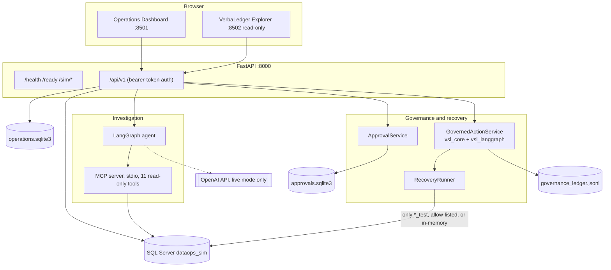

# AI DataOps Agent with VSL Governance

An AI-assisted DataOps incident workflow for a **simulated** data platform. An agent investigates pipeline incidents using
read-only tool evidence, a person reviews and approves any proposed fix, a VSL governance layer gates the protected action,
a tightly allow-listed simulated recovery runs, and every governance decision is recorded in a hash-chained ledger
(VerbaLedger).

> **Scope: simulator only.** The data is synthetic, services run locally, and recovery acts only on a simulation database
> whose name ends in `_test` (or an in-memory fake). Nothing here touches a real company system. Authentication is a
> development-only static-token scheme. See [Known limitations](#13-known-limitations-and-unverified-integrations) before
> relying on anything. This is **not production-ready**; see [docs/release-readiness.md](docs/release-readiness.md).

## Contents

1. [Problem and intended users](#1-problem-statement-and-intended-users)
2. [Key features and boundaries](#2-key-features-and-boundaries)
3. [Architecture](#3-architecture-overview)
4. [Technology stack](#4-technology-stack)
5. [Prerequisites](#5-prerequisites)
6. [Windows installation and configuration](#6-windows-installation-and-configuration)
7. [Safe local startup and service URLs](#7-safe-local-startup-and-service-urls)
8. [Authentication setup](#8-authentication-setup)
9. [Main workflow and demo](#9-main-workflow-and-demo)
10. [Testing and test status](#10-testing-and-test-status)
11. [Governance and safety summary](#11-governance-approval-evidence-integrity-idempotency-and-recovery-safety)
12. [Repository map](#12-repository-map)
13. [Known limitations and unverified integrations](#13-known-limitations-and-unverified-integrations)
14. [Detailed documentation](#14-detailed-documentation)
15. [Shutdown and troubleshooting](#15-clean-shutdown-and-troubleshooting)

---

## 1. Problem statement and intended users

Finding out *why* a data pipeline failed, and fixing it safely, is slow, and delegating it to an AI agent is risky unless the
agent's power is bounded and its decisions are auditable. This project is a reference implementation of that pattern: the model
can read evidence but cannot act; a fix is only ever a *proposal*; and it becomes an action only after a verified report,
cited evidence and a human approval bound to that exact action.

**Intended users:** engineers evaluating governed AI-agent patterns (LangGraph orchestration, MCP tooling, human-in-the-loop
approval, audit trails), and reviewers of VSL-based governance. It is a reference design and learning project.

## 2. Key features and boundaries

| Feature | Boundary |
|---|---|
| Incident investigation by a LangGraph agent using 11 read-only MCP diagnostic tools | Default mode is an **offline deterministic heuristic**, not an LLM. Live OpenAI mode (`INVESTIGATION_MODE=live`) is implemented but **has not been run or validated** |
| Evidence-grounded reports: findings must cite evidence ids that came from real tool calls | Conclusions are unvalidated on real incidents |
| Human Review: exact-action, single-use, expiring, HMAC-sealed approvals; per-action approver permission | Dev static tokens only; server enforces expiry |
| VSL governance: 2 compiled invariants + 1 compiled PreNode, plus ordinary application controls (target guard, idempotency, lifecycle, evidence integrity) | Only those three constructs are compiled VSL gates; everything else is plain Python and is labelled as such |
| Controlled recovery: 2 allow-listed actions (`rerun_pipeline`, `remove_injected_condition`) with precondition and independent verification | Simulation only; refuses any database not ending `_test` or not in `RECOVERY_TARGET_ALLOWLIST`; external effects are not guaranteed exactly-once |
| VerbaLedger: hash-chained JSON Lines audit log with a read-only Explorer | Tamper-**evident** within one file; not immutable, not externally anchored |
| Operations Dashboard and Explorer (Streamlit) | Development UI, no UI login |
| Optional GitHub Issues ticketing | Tested with fakes only |

Not implemented: real data-platform integration, a production identity provider, TLS, rate limiting across replicas,
executable compensation/rollback (a compensation *plan* is only proposed), vector search/RAG.

## 3. Architecture overview



Four stores, on purpose: SQL Server `dataops_sim` (simulation; read-only in the API), `data/operations.sqlite3` (workflow
incidents, investigations, recoveries), `data/approvals.sqlite3` (approvals), `data/governance_ledger.jsonl` (audit). The
recovery pipeline order and the approval lifecycle are in [docs/architecture.md](docs/architecture.md) and
[docs/governance-and-safety.md](docs/governance-and-safety.md).

## 4. Technology stack

Taken from `requirements.txt`, `requirements-dashboard.txt`, `pytest.ini` and `.github/workflows/ci.yml`:

| Layer | Technology (pinned) |
|---|---|
| Language | Python 3.10+ (CI matrix: 3.10 and 3.12) |
| API | FastAPI 0.143.2, Uvicorn 0.54.0, Pydantic 2.14.1, pydantic-settings 2.15.0 |
| Data | SQLAlchemy 2.0.54 + pyodbc 5.3.0 (SQL Server simulator), SQLite (workflow and approval stores), JSON Lines (ledger) |
| Agent | LangGraph 1.2.16, MCP SDK `mcp` 2.3.0 (stdio), `openai` 3.31.0 (live mode only) |
| Governance | `super-semantics-vsl` (`vsl_core`) and `vsl-langgraph`, both pinned to GitHub commits |
| UI | Streamlit 1.65.0, Plotly 7.1.0, pandas 2.3.3 |
| Tests | pytest 9.1.1, httpx, Streamlit `AppTest` |
| Packaging | `Dockerfile`, `docker-compose.yml`, GitHub Actions CI (present; not run by the author) |

## 5. Prerequisites

* Windows 10/11 with PowerShell, Git, 64-bit Python 3.10 or newer.
* Network access to GitHub (the VSL packages install from pinned GitHub commits) and PyPI.
* For the SQL Server simulator: a local SQL Server (Express is fine) and Microsoft ODBC Driver 17 or 18
  ([docs/windows-setup.md](docs/windows-setup.md)). The automated tests do **not** need SQL Server.
* No OpenAI key is needed for anything described here.

## 6. Windows installation and configuration

```powershell
cd "<path-to-your-clone>\AI DataOps Agent"
python -m venv .venv
.\.venv\Scripts\Activate.ps1
python -m pip install -r requirements.txt
python -m pip install -r requirements-dashboard.txt
Copy-Item .env.example .env        # first time only
notepad .env                       # edit yourself; never commit or paste it
```

If activation is blocked: `Set-ExecutionPolicy -Scope Process RemoteSigned` (this window only).

Minimum `.env` for Windows authentication to a named instance:

```text
DB_SERVER=localhost\SQLEXPRESS03
DB_NAME=dataops_sim
DB_AUTH_MODE=windows
DB_TRUST_SERVER_CERTIFICATE=true     # local development only
```

All variables, defaults and safety restrictions: [docs/installation-and-configuration.md](docs/installation-and-configuration.md).

Prepare the simulator database once (each script prints the database it uses; none deletes data except `db_reset`, which you
should not need):

```powershell
python -m scripts.check_prereqs     # read-only diagnosis of driver, connection and auth
python -m scripts.db_init           # creates the database and tables
python -m scripts.db_seed           # deterministic baseline; idempotent
python -m scripts.db_verify         # checks tables and baseline counts
python -m scripts.check_database_identity   # read-only: reports which server/database the app will use
```

## 7. Safe local startup and service URLs

```powershell
.\.venv\Scripts\python.exe -m scripts.dev_stack --show-approver-token --open
```

Wait for `VERIFIED. Open:`. Flags: `--api-port`, `--ops-port`, `--ledger-port`, `--no-ui`, `--check-only`, `--open`,
`--show-approver-token`. The launcher refuses to run with `APP_ENV=production`, never kills processes, and stops only what it
started.

| Service | URL |
|---|---|
| API interactive docs | <http://127.0.0.1:8000/docs> |
| Health / readiness | <http://127.0.0.1:8000/health>, <http://127.0.0.1:8000/ready> |
| Operations Dashboard | <http://127.0.0.1:8501> |
| VerbaLedger Explorer (read-only) | <http://127.0.0.1:8502> |

API only (no auth configured, so `/api/v1` calls other than health need a token you have not enabled): `python -m uvicorn app.main:app --host 127.0.0.1 --port 8000`.

**Recovery is off with `DB_NAME=dataops_sim`.** The recovery service refuses to start unless the database is in-memory or
ends in `_test` and is allow-listed, so Human Review returns HTTP 503 `recovery_unavailable` by design. Details and the
separate-database procedure: [docs/installation-and-configuration.md](docs/installation-and-configuration.md#enabling-recovery-safely).

## 8. Authentication setup

* **Development (`dev_static`)**: `scripts.dev_stack` generates random tokens on first run into `.dev/dev_auth.json`
  (git-ignored) and passes them to each child process. Only SHA-256 digests reach the API's credential list. Use
  `--show-approver-token` to print the approver token once; you type it into the Human Review form.
* **Default (`APPROVAL_AUTH_MODE=disabled`)**: nobody can approve; `/api/v1` calls that need a token return 401.
* **Production**: `APP_ENV=production` refuses `dev_static` and refuses to start unless `DATABASE_URL`, `APPROVAL_STORE_PATH`,
  `GOVERNANCE_LEDGER_PATH` and `DB_NAME` are explicit. No production identity provider exists in this repository.
* Never put tokens in screenshots, issues or chats. Placeholders only appear in `.env.example`.

## 9. Main workflow and demo

1. **Incident** — select or import (`POST /api/v1/simulator/incidents/{id}/import`), or create (`POST /api/v1/incidents`).
2. **Investigate** — `POST /api/v1/incidents/{id}/investigations` (202; poll the investigation or `/report`).
3. **Propose** — `POST /api/v1/incidents/{id}/recoveries` derives an action from cited evidence. Nothing is authorised.
4. **Review** — a person approves or rejects (`POST /api/v1/approvals/{request_id}/decision`). Approval executes nothing.
5. **Resume** — `POST /api/v1/recoveries/{id}/resume` runs the VSL gates, ledger check, target check, single-use claim,
   execution and independent verification.
6. **Audit** — `GET /api/v1/recoveries/{id}/governance`, VerbaLedger Explorer, `/api/v1/ledger/*`.

Runnable demos and the offline scripted run: [docs/demo-guide.md](docs/demo-guide.md). Quickest safe demo, no database,
network or model:

```powershell
python -m pytest tests/test_governance_demo.py -s -q
```

## 10. Testing and test status

```powershell
python -m pytest -q                  # full offline suite; no SQL Server, no OpenAI key
python -m pytest -q -rs              # same, listing why tests were skipped
```

**Truthful status (2026-11-02, Linux workspace, Python 3.10, run in five file chunks because of a 120 s tool limit):**
2,306 tests collected; **2,261 passed, 45 skipped, 0 failed**. The 45 skips are 44 SQL Server integration tests and 1 live-model
test; **a skip is not a pass**. Not re-run on Windows, on Python 3.12, or in CI by the author. Details and exact commands:
[docs/testing-and-verification.md](docs/testing-and-verification.md).

SQL Server integration tests are **destructive** (they wipe and reseed their target). They are skipped unless explicitly
enabled and now also require `SQLSERVER_TESTS_CONFIRM_WIPE=<exact disposable database name>`; they refuse `dataops_sim` and
`dataops_demo_test`. They have not been run. The live LLM check (`python -m scripts.openai_smoke --yes-call-openai`) has not
been run.

## 11. Governance, approval, evidence integrity, idempotency and recovery safety

* **Authority.** Model output cannot authorise anything. Approval is a person with the per-action permission (or, if you opt in,
  `policy:risk-policy-v1` for one bounded low-risk retry; off by default).
* **Approval.** Bound to the exact action, parameters, target and evidence; HMAC-sealed; single-use; expires (default 30 min,
  max 24 h). Expiry is enforced server-side; the dashboard shows an expired request as **Expired** even while the stored status is
  still `pending` and offers no decision control.
* **Evidence.** Cited evidence needs verified provenance metadata and freshness (60 min) at proposal and again at execution;
  a SHA-256 digest of the evidence is recorded in the ledger at request time and re-verified before execution. Legacy requests
  without a digest fail closed.
* **Idempotency.** A deterministic key (incident, action, parameters, target) with one open execution claim per key; an
  uncertain outcome blocks reruns until a person reconciles it. This is **not** an exactly-once guarantee for external effects.
* **Recovery.** Target allow-list, `_test` suffix, `SELECT DB_NAME()` verification, independent postcondition check; failure
  or unknown outcome produces an escalation and a compensation *plan that is only proposed*.
* **Compiled vs ordinary.** 2 invariants + 1 PreNode are compiled VSL gates; all else is application code.
* **Dashboard verdicts.** Per-PreNode verdicts are `passed`, `failed`, `unknown` or `not_recorded`, with basis `recorded`,
  `implied_by_later_step` or `none`. A missing record is shown as `NOT RECORDED (this is not a pass)`. Proposed, unauthorised,
  unattempted or merely approved actions are never shown as executed.

Full detail: [docs/governance-and-safety.md](docs/governance-and-safety.md).

## 12. Repository map

```text
app/            api/v1 routes, agent (LangGraph), mcp_server, diagnostics, governance (VSL), recovery, services,
                persistence, simulation, demo, integrations, core
dashboard/      ops_app.py, ledger_app.py, clients and view models (Streamlit)
scripts/        db_*, dev_stack, check_prereqs, check_database_identity, scenario, investigate, stub_governance_demo, ...
tests/          pytest suite (tests/integration/ needs a real SQL Server and is destructive)
docs/           design and operating documentation, docs/screenshots/
data/ logs/ .dev/ .env     local runtime state and secrets; all git-ignored
```

## 13. Known limitations and unverified integrations

* **Not verified by the author:** SQL Server integration tests; any recovery against a real `_test` database; the live OpenAI
  path (T-20); the full suite on Windows and Python 3.12; Docker build and compose; GitHub Actions execution; GitHub ticketing
  against real GitHub; the real-browser stub check (`scripts.stub_governance_demo`).
* Evidence `collected_at` is stamped locally and is unsigned; the digest detects later alteration of stored evidence, not
  fabrication at collection time.
* INV-14 (fact vs hypothesis) is **partially** enforced: structure and deterministic review flags, no automatic promotion.
* Compensation is design-only. `reconcile_uncertain` is a service method with no HTTP or CLI route.
* SQLite and JSONL are single-host stores: no multi-replica support. The unauthenticated `/sim/*` routes are for local use.
* Screenshots under `docs/screenshots/` were captured in a Linux sandbox with the in-memory simulator and predate the
  governance panel work.

Full list with the next safe step for each: [docs/release-readiness.md](docs/release-readiness.md).

## 14. Detailed documentation

| Document | Contents |
|---|---|
| [docs/architecture.md](docs/architecture.md) | Components, data flow, stores, recovery pipeline |
| [docs/installation-and-configuration.md](docs/installation-and-configuration.md) | Install, variables, auth modes, database separation |
| [docs/api-reference.md](docs/api-reference.md) | Every route, permissions, errors |
| [docs/governance-and-safety.md](docs/governance-and-safety.md) | VSL gates, approvals, expiry, evidence, idempotency, ledger, verdicts |
| [docs/testing-and-verification.md](docs/testing-and-verification.md) | Commands, results, skips, outstanding checks |
| [docs/demo-guide.md](docs/demo-guide.md) | Four governance demos and the stub dashboard check |
| [docs/troubleshooting.md](docs/troubleshooting.md) | Symptoms and fixes |
| [docs/release-readiness.md](docs/release-readiness.md) | Verification status of every item |
| Governance detail | [catalogue](docs/governance-catalogue.md), [architecture](docs/governance-architecture.md), [evidence policy](docs/governance-evidence-policy.md), [acceptance tests](docs/governance-acceptance-tests.md), [audit and gap analysis](docs/governance-audit-and-gap-analysis.md), [pending approvals](docs/pending-approvals.md) |
| Earlier notes | [agent](docs/agent.md), [diagnostics](docs/diagnostics.md), [MCP server](docs/mcp-server.md), [simulation](docs/simulation.md), [vsl-governance](docs/vsl-governance.md), [windows-setup](docs/windows-setup.md), phase notes (`docs/phase*.md`) |

## 15. Clean shutdown and troubleshooting

* Stop the stack with `Ctrl+C` in the launcher window; it stops only the processes it started. Do not kill other processes
  on ports 8000/8501/8502 unless you started them.
* Remove local state only if you mean to: `data/`, `logs/` and `.dev/` are generated and git-ignored.
* Port busy: `Get-NetTCPConnection -LocalPort 8000 -State Listen | Select OwningProcess`, or use `--api-port 8010`.
* `401` in a dashboard: you started it without the launcher; use `scripts.dev_stack`.
* `503 recovery_unavailable`: expected with `DB_NAME=dataops_sim`.

More symptoms: [docs/troubleshooting.md](docs/troubleshooting.md).
