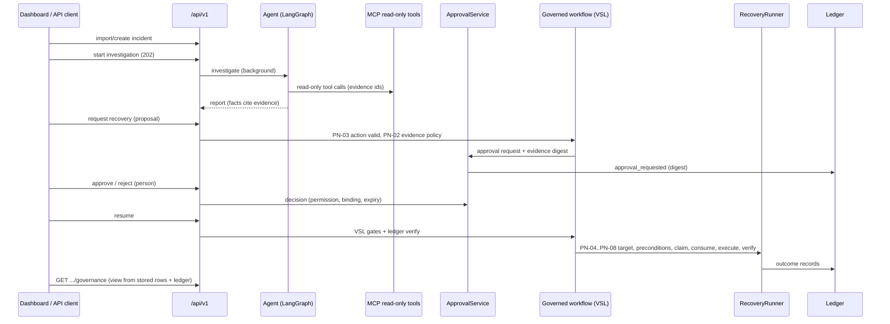

# Architecture

Describes the repository as implemented. Governance specifics are in [governance-and-safety.md](governance-and-safety.md); the
route list is in [api-reference.md](api-reference.md). (An earlier version of this file described a planned design; it has been
replaced.)

## Purpose

Investigate data-pipeline incidents using evidence from read-only tools, separate confirmed observations from hypotheses,
propose a corrective action, and run only governed, human-authorised recovery on a **simulated** environment. When evidence is
insufficient the root cause is reported as unconfirmed.

## Components

| Component | Code | Role |
|---|---|---|
| FastAPI root app | `app/main.py` | `/health`, `/ready`, `/sim/*`; mounts `/api/v1` |
| Versioned API | `app/api/v1/` (`routes/`, `security.py`, `permissions.py`, `errors.py`) | Bearer-token auth, roles, uniform errors, throttling of failed auth |
| Services | `app/services/` (`container.py`, `investigations.py`, `recoveries.py`, `status.py`) | Wiring, workflow logic, derived workflow status |
| Investigation agent | `app/agent/` | LangGraph state machine: receive incident, plan, execute tools, evaluate, generate report. Offline heuristic by default; optional OpenAI client |
| MCP server | `app/mcp_server/`, `app/diagnostics/readonly.py` | 11 read-only diagnostic tools over stdio; `ReadOnlyRepo.READ_METHODS` allow-list (application-level, not a read-only DB login) |
| Simulator | `app/simulation/`, `scripts/db_*.py`, `scripts/scenario.py` | SQL Server `dataops_sim` pipelines, runs, scenarios, simulator incidents |
| Synthetic demo set | `app/demo/` | 100 in-process `DEMO-nnnn` records; browse-only |
| Governance | `app/governance/` | VSL policy, gate compilation, governed workflow, ledger, ledger view, audit CLI |
| Approvals and recovery | `app/recovery/` | actions, approvals (binding, HMAC, single use, expiry), auth, runner, workflow, evidence/idempotency, expiry, governance view, PreNode verdicts, lifecycle, catalogue |
| Persistence | `app/persistence/` | SQLite schema and repositories for the operations store |
| Ticketing | `app/integrations/github_issues.py` | Optional GitHub Issues |
| Dashboards | `dashboard/ops_app.py`, `dashboard/ledger_app.py` | Streamlit Operations Dashboard (:8501) and read-only VerbaLedger Explorer (:8502) |
| Launcher | `scripts/dev_stack.py` | Starts API and both dashboards with consistent development tokens |

## Data flow

Recovery order (enforced in `app/recovery/runner.py`): attempt record, suspension/ledger check, precondition (target and
`DB_NAME()`), idempotency claim, single-use consume, execute, independent verification, result record.

## Stores

| Store | Holds | Writer |
|---|---|---|
| SQL Server `dataops_sim` | Simulated pipelines, runs, validation results, simulator incidents | Setup scripts and simulator; recovery only on allow-listed `*_test` databases |
| `data/operations.sqlite3` | Workflow incidents, investigations, recoveries, tickets | API |
| `data/approvals.sqlite3` | Approval requests, decisions, evidence metadata, execution claims | Approval service |
| `data/governance_ledger.jsonl` | Hash-chained governance events | Governance layer (Explorer is read-only) |

There is no automatic synchronisation from SQL Server to the workflow store; a simulator incident enters the workflow only through
the explicit, idempotent import route.

## Design decisions and boundaries

* The model reads and reports; it never receives write tools and its output is never executed directly.
* Authorisation is separate from execution; approval executes nothing.
* VSL constructs are used where they fit (2 invariants, 1 PreNode); other controls are ordinary, tested Python and are labelled so.
* Single host by design (SQLite, JSONL ledger, one Uvicorn worker). No multi-replica support.
* Not implemented: real data-platform connectors, a production identity provider, TLS, executable compensation.

See also the earlier per-phase notes: [agent.md](agent.md), [diagnostics.md](diagnostics.md), [mcp-server.md](mcp-server.md),
[simulation.md](simulation.md), [vsl-governance.md](vsl-governance.md).
